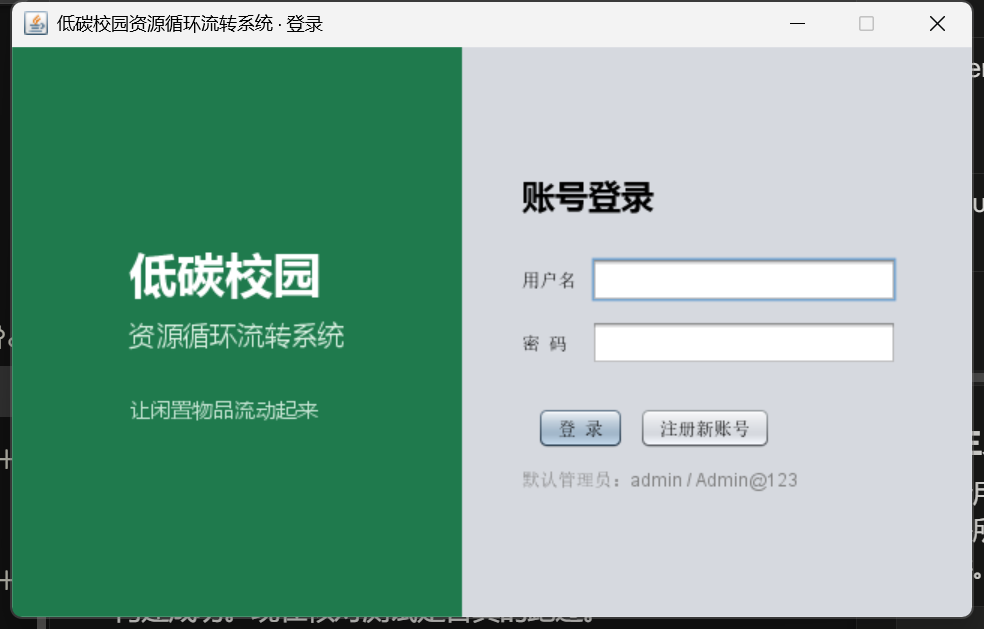
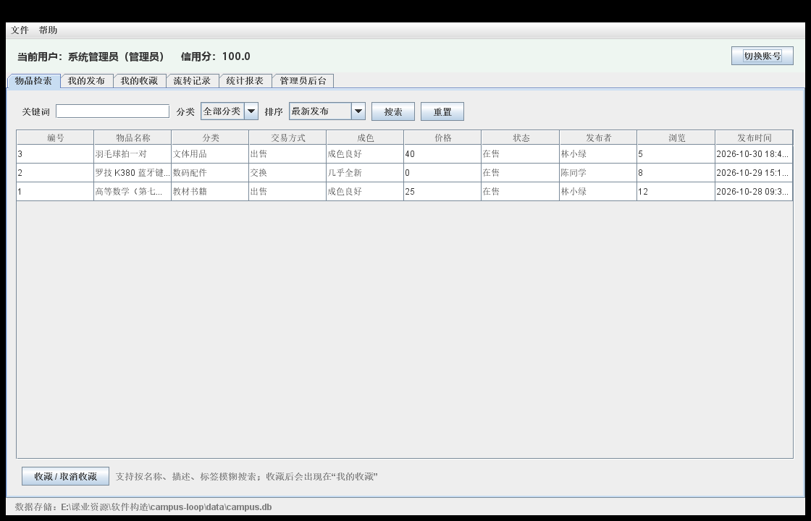

# 低碳校园资源循环流转桌面系统（campus-loop）

> 《软件构造》分组实验 —— 三人小组项目
> 一个帮助校园闲置物品"流动起来"的 Java 桌面应用：发布、检索、收藏、流转、评价，并按分类折算低碳减排量。



## 一、功能概览

| 模块 | 能力 | 状态 |
|---|---|---|
| 账号 | 注册、登录、修改密码、账号启停 | 已实现 |
| 物品 | 发布、修改、下架、详情、浏览量 | 已实现 |
| 检索 | 关键词（标题/描述/标签）、分类筛选、四种排序 | 已实现 |
| 收藏 | 收藏、取消收藏、我的收藏 | 已实现 |
| 流转 | 意向 → 接受 → 完成 / 取消的状态机 | 迭代 2 |
| 评价 | 成交后互评、信用分更新 | 迭代 2 |
| 统计 | 用户/物品/在售/分类分布、碳减排估算、CSV 导出 | 部分实现（导出迭代 2） |
| 管理 | 用户管理、分类维护、违规下架、操作日志 | 已实现（日志可追溯） |



## 二、技术栈

| 项 | 选择 |
|---|---|
| 语言 | Java 8 |
| 界面 | Swing（Nimbus 外观，中文字体适配） |
| 数据库 | SQLite 3 + JDBC（`org.xerial:sqlite-jdbc`） |
| 构建 | Maven 多模块 + Maven Wrapper |
| 测试 | JUnit 4 |
| 打包 | `maven-shade-plugin` 生成可执行 fat jar |

## 三、快速开始

### 环境要求

- JDK 8 或更高（推荐 JDK 8，与编译目标一致）
- 无需安装 Maven，项目自带 `mvnw`

### 构建

Windows（cmd / PowerShell）：

```bash
mvnw.cmd clean package
```

Git Bash / macOS / Linux：

```bash
./mvnw clean package
```

### 运行

```bash
java -Dfile.encoding=UTF-8 -jar campus-app/target/campus-loop.jar
```

首次运行会在 `data/campus.db` 自动建库并写入演示数据；删除该文件即可恢复到初始状态。

### 默认账号

| 角色 | 用户名 | 密码 |
|---|---|---|
| 管理员 | `admin` | `Admin@123` |
| 学生 | `linxiaolv` | `Student@123` |
| 学生 | `chenxy` | `Student@123` |

## 四、项目结构

```
campus-loop/
├─ pom.xml                 父 POM：模块、版本、编码
├─ mvnw / mvnw.cmd         Maven Wrapper
├─ campus-core/            领域模型、枚举、异常、工具、仓储与服务接口
├─ campus-dao/             SQLite 实现、连接与事务、schema 与种子数据
├─ campus-service/         业务规则、校验、统计
├─ campus-ui/              Swing 窗口、面板、对话框、表格模型
├─ campus-app/             组合根 + 可执行 Jar
├─ data/                   运行时数据库（不入库）
├─ docs/
│  ├─ 项目管理/            分工与交接方案
│  ├─ 设计/                需求规格、模块化设计、数据库设计、接口契约、UML
│  ├─ 交接/                每轮交接单
│  ├─ 协作/                Git 规范、会议记录、提交记录
│  └─ 截图/                运行截图
└─ README.md
```

依赖方向单向：`core ← dao / service / ui ← app`。业务层只依赖接口，可注入伪造仓储做单测。

## 五、设计要点

| 模式 | 落点 |
|---|---|
| 单例 | `DatabaseManager`、`AppConfig` |
| 工厂 | `DaoFactory`、`ServiceFactory` |
| 模板方法 | `AbstractJdbcDao` |
| 建造者 | `ItemQuery` |
| 观察者 / 策略 | 迭代 3、迭代 4 引入（物品状态通知、信用分与排序策略） |

更多见 [模块化设计](docs/设计/模块化设计.md) 与 [UML 类图](docs/设计/UML/类图.png)。

## 六、测试

```bash
./mvnw test
```

当前 34 个用例：工具类 21 个、业务层 6 个（内存仓储替身）、数据层 7 个（临时 SQLite 文件）。

## 七、文档索引

| 文档 | 说明 |
|---|---|
| [小组分工与交接方案](docs/项目管理/小组分工与交接方案.md) | 三人分工、交接机制、DoD |
| [需求规格](docs/设计/需求规格.md) | 角色、功能与非功能需求 |
| [数据库设计](docs/设计/数据库设计.md) | 表结构、索引、事务、种子数据 |
| [接口契约](docs/设计/接口契约.md) | 冻结的接口签名与错误契约 |
| [类图](docs/设计/UML/类图.png) / [登录时序图](docs/设计/UML/时序图-登录.png) / [物品流转时序图](docs/设计/UML/时序图-物品流转.png) | PlantUML 绘制，源文件同目录 |
| [Git 协作规范](docs/协作/Git协作规范.md) | 分支、提交、推送、证据 |
| [会议记录](docs/协作/小组会议记录.md) | 计划会与验收会 |
| [迭代 1 交接单](docs/交接/) | 三位成员各自交接 |

## 八、迭代计划

| 迭代 | 内容 | 标签 |
|---|---|---|
| 1 | 分工、接口、数据库、可运行骨架 | `iter1` |
| 2 | 流转与评价业务、CSV 导出、单测补全 | `iter2` |
| 3 | 界面联调、管理员后台完善、集成测试 | `iter3` |
| 4 | 重构、打包、报告、PPT、演示视频 | `v1.0` |

## 九、已知限制

- 流转与评价仅有接口，界面显示为占位页
- 统计页的 CSV 导出按钮在迭代 2 接入
- 图片上传、分页、二级分类尚未实现

## 十、开发约定

- 全项目 UTF-8，Java 8 语法
- 提交信息：`类型(范围): 中文描述`
- 每轮结束必须 `clean package` 与 `test` 双绿后合并
