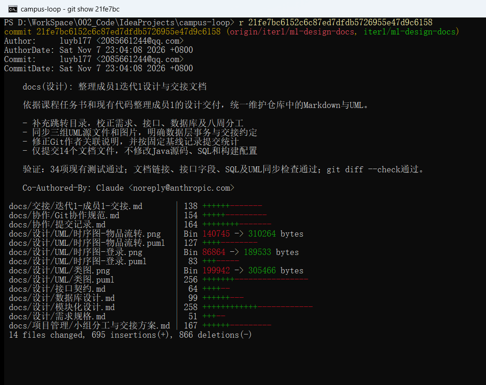
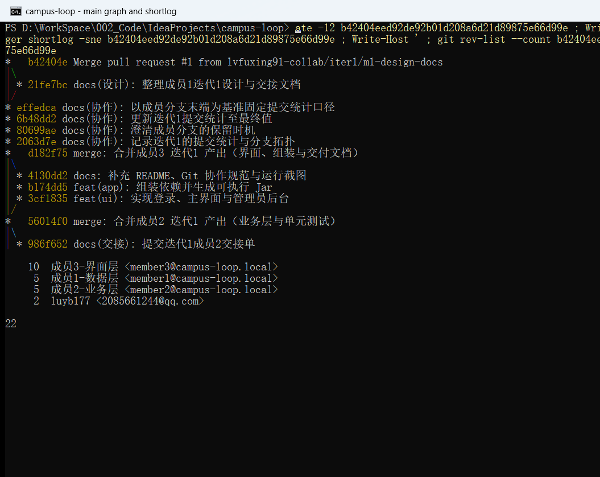

# 提交记录（迭代1）

## 目录

- [一、统计口径](#一统计口径)
- [二、作者提交次数](#二作者提交次数)
- [三、成员1开发线](#三成员1开发线)
- [四、主干提交明细](#四主干提交明细)
- [五、分支拓扑](#五分支拓扑)
- [六、复现与截图](#六复现与截图)

## 一、统计口径

- 记录日期：2026-11-07。
- 主干基线：b42404eed92de92b01d208a6d21d89875e66d99e（b42404e，PR #1合并后的main）。
- 统计范围：该提交及其可达历史；主干共22次，其中普通提交18次、合并提交4次。
- 角色提交基线：effedca（成员各分支产出合入主干后的末端），该基线共20次，普通17次、合并3次。
- 作者按Git author字段分组；工作区未提交修改不计入统计。

## 二、作者提交次数

| Git作者 | 普通提交 | 合并提交 | 合计 |
|---|---:|---:|---:|
| 成员1（成员1-数据层 / luyb177） | 5 | 2 | 7 |
| 成员2-业务层 &lt;member2@campus-loop.local&gt; | 4 | 1 | 5 |
| 成员3-界面层 &lt;member3@campus-loop.local&gt; | 9 | 1 | 10 |

成员1在Git中有两个作者标识：迭代1开发阶段的角色邮箱`member1@campus-loop.local`（4次开发提交、1次合并），以及后续整理阶段使用的个人账号`luyb177 <2085661244@qq.com>`（1次开发提交、1次合并）。二者为同一成员，本表合并统计为7次；`git shortlog`按作者字符串分组，因此输出中会显示两行。

## 三、成员1开发线

成员1的迭代1提交分两段：原开发分支末端f1b7f09之上有4次开发提交，62438d0以角色身份执行合并；随后通过PR #1提交设计文档整理（21fe7bc）并由b42404e合并到main。

| 提交 | 类型 | 作者 | 内容 |
|---|---|---|---|
| 21fe7bc | 开发 | 成员1（luyb177） | docs(设计): 整理成员1迭代1设计与交接文档 |
| b42404e | 合并 | 成员1（luyb177） | Merge pull request #1 from iter1/m1-design-docs |
| 8acd0d0 | 开发 | 成员1-数据层 | docs(设计): 完成需求规格、数据库设计与接口契约 |
| 8dfc384 | 开发 | 成员1-数据层 | feat(core): 定义实体、枚举、异常与仓储接口 |
| e50d899 | 开发 | 成员1-数据层 | feat(dao): 实现 SQLite 仓储与数据库初始化 |
| f1b7f09 | 开发 | 成员1-数据层 | test(dao): 增加数据层集成测试 |
| 62438d0 | 合并 | 成员1-数据层 | merge: 合并成员1 迭代1 产出（设计文档与数据层） |

## 四、主干提交明细

| 提交 | 日期 | Git作者 | 类型 | 内容 |
|---|---|---|---|---|
| 10c4bd3 | 2026-11-04 | 成员3-界面层 | 普通 | build: 初始化 Maven 多模块骨架与 Maven Wrapper |
| 7f7214f | 2026-11-04 | 成员3-界面层 | 普通 | chore: 统一换行符策略 |
| 8acd0d0 | 2026-11-04 | 成员1-数据层 | 普通 | docs(设计): 完成需求规格、数据库设计与接口契约 |
| 8dfc384 | 2026-11-04 | 成员1-数据层 | 普通 | feat(core): 定义实体、枚举、异常与仓储接口 |
| e50d899 | 2026-11-04 | 成员1-数据层 | 普通 | feat(dao): 实现 SQLite 仓储与数据库初始化 |
| f1b7f09 | 2026-11-04 | 成员1-数据层 | 普通 | test(dao): 增加数据层集成测试 |
| 62438d0 | 2026-11-04 | 成员1-数据层 | 合并 | merge: 合并成员1 迭代1 产出（设计文档与数据层） |
| 910fcd1 | 2026-11-04 | 成员2-业务层 | 普通 | feat(core): 定义服务接口与通用工具 |
| f4f70ec | 2026-11-04 | 成员2-业务层 | 普通 | feat(service): 实现认证、物品与管理业务 |
| bd465f8 | 2026-11-04 | 成员2-业务层 | 普通 | test(service): 增加工具类与登录流程单元测试 |
| 986f652 | 2026-11-04 | 成员2-业务层 | 普通 | docs(交接): 提交迭代1成员2交接单 |
| 56014f0 | 2026-11-04 | 成员2-业务层 | 合并 | merge: 合并成员2 迭代1 产出（业务层与单元测试） |
| 3cf1835 | 2026-11-04 | 成员3-界面层 | 普通 | feat(ui): 实现登录、主界面与管理员后台 |
| b174dd5 | 2026-11-04 | 成员3-界面层 | 普通 | feat(app): 组装依赖并生成可执行 Jar |
| 4130dd2 | 2026-11-04 | 成员3-界面层 | 普通 | docs: 补充 README、Git 协作规范与运行截图 |
| d182f75 | 2026-11-04 | 成员3-界面层 | 合并 | merge: 合并成员3 迭代1 产出（界面、组装与交付文档） |
| 2063d7e | 2026-11-04 | 成员3-界面层 | 普通 | docs(协作): 记录迭代1的提交统计与分支拓扑 |
| 80699ae | 2026-11-04 | 成员3-界面层 | 普通 | docs(协作): 澄清成员分支的保留时机 |
| 6b48dd2 | 2026-11-04 | 成员3-界面层 | 普通 | docs(协作): 更新迭代1提交统计至最终值 |
| effedca | 2026-11-04 | 成员3-界面层 | 普通 | docs(协作): 以成员分支末端为基准固定提交统计口径 |
| 21fe7bc | 2026-11-07 | 成员1 | 普通 | docs(设计): 整理成员1迭代1设计与交接文档 |
| b42404e | 2026-11-07 | 成员1 | 合并 | Merge pull request #1 from iter1/m1-design-docs |

## 五、分支拓扑

```text
*   b42404e Merge pull request #1 from lvfuxing91-collab/iter1/m1-design-docs
|\
| * 21fe7bc docs(设计): 整理成员1迭代1设计与交接文档
|/
* effedca docs(协作): 以成员分支末端为基准固定提交统计口径
* 6b48dd2 docs(协作): 更新迭代1提交统计至最终值
* 80699ae docs(协作): 澄清成员分支的保留时机
* 2063d7e docs(协作): 记录迭代1的提交统计与分支拓扑
*   d182f75 merge: 合并成员3 迭代1 产出（界面、组装与交付文档）
|\
| * 4130dd2 docs: 补充 README、Git 协作规范与运行截图
| * b174dd5 feat(app): 组装依赖并生成可执行 Jar
| * 3cf1835 feat(ui): 实现登录、主界面与管理员后台
|/
*   56014f0 merge: 合并成员2 迭代1 产出（业务层与单元测试）
|\
| * 986f652 docs(交接): 提交迭代1成员2交接单
| * bd465f8 test(service): 增加工具类与登录流程单元测试
| * f4f70ec feat(service): 实现认证、物品与管理业务
| * 910fcd1 feat(core): 定义服务接口与通用工具
|/
*   62438d0 merge: 合并成员1 迭代1 产出（设计文档与数据层）
|\
| * f1b7f09 test(dao): 增加数据层集成测试
| * e50d899 feat(dao): 实现 SQLite 仓储与数据库初始化
| * 8dfc384 feat(core): 定义实体、枚举、异常与仓储接口
| * 8acd0d0 docs(设计): 完成需求规格、数据库设计与接口契约
|/
* 7f7214f chore: 统一换行符策略
* 10c4bd3 build: 初始化 Maven 多模块骨架与 Maven Wrapper
```

## 六、复现与截图

以下命令使用固定哈希，不随分支继续开发而改变统计结果。

```bash
git shortlog -sne b42404eed92de92b01d208a6d21d89875e66d99e
```

```bash
git rev-list --count b42404eed92de92b01d208a6d21d89875e66d99e
```

```bash
git log --graph --oneline --no-decorate b42404eed92de92b01d208a6d21d89875e66d99e
```

```bash
git show --stat 21fe7bc6152c6c87ed7dfdb5726955e47d9c6158
```

### 6.1 截图清单

课程要求提交记录截图。截图从终端、IDE或GitHub提交页获取，文件名与内容对应如下，统一存放在`docs/协作/截图/`：

| 文件 | 内容 | 来源 |
|---|---|---|
| `01-成员1文档提交-21fe7bc.png` | 21fe7bc的提交作者、时间、说明及14个文件变更 | `git show --stat=68,50 --format=fuller 21fe7bc` |
| `02-main合并与统计-b42404e.png` | 主干拓扑、`git shortlog`作者次数、22次提交计数 | `git log --graph`、`git shortlog -sne`、`git rev-list --count` |





截图必须展示上表对应的真实命令输出或仓库页面，注明commit基线；不使用文本拓扑代替截图，也不以排版生成的图片冒充终端记录。

GitHub贡献关联依赖提交作者邮箱及分支等条件，不按推送账号自动改写作者。协作方式见[Git协作规范](Git协作规范.md)。

GitHub贡献关联依赖提交作者邮箱及分支等条件，不按推送账号自动改写作者。协作方式见[Git协作规范](Git协作规范.md)。
