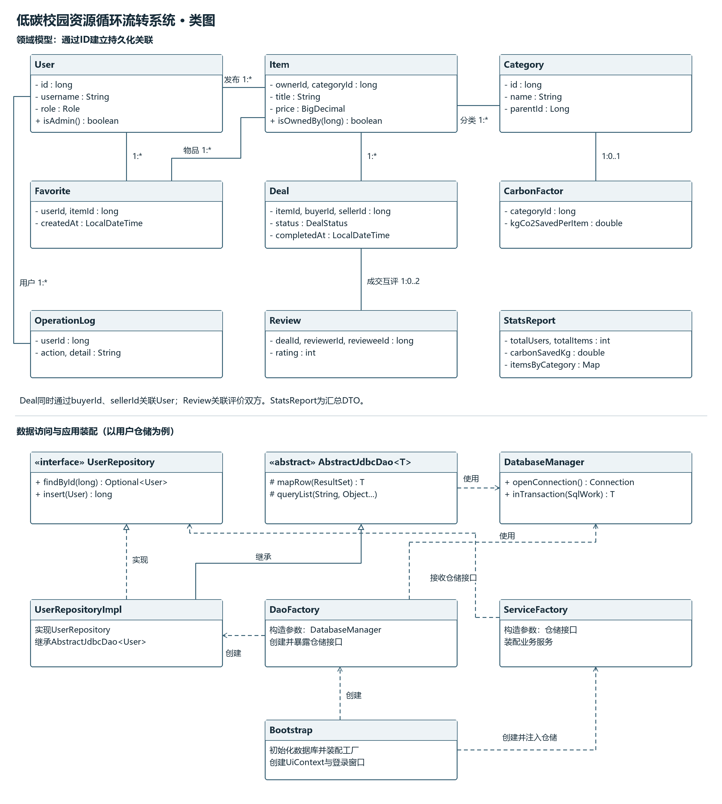
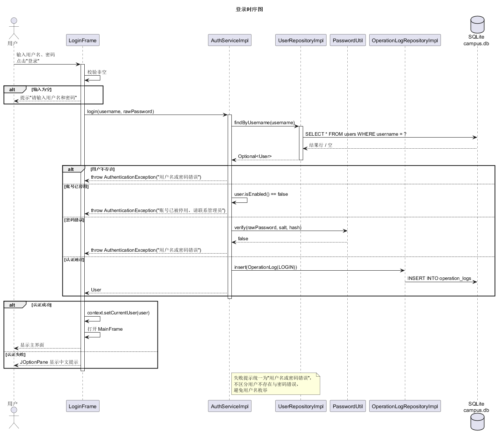
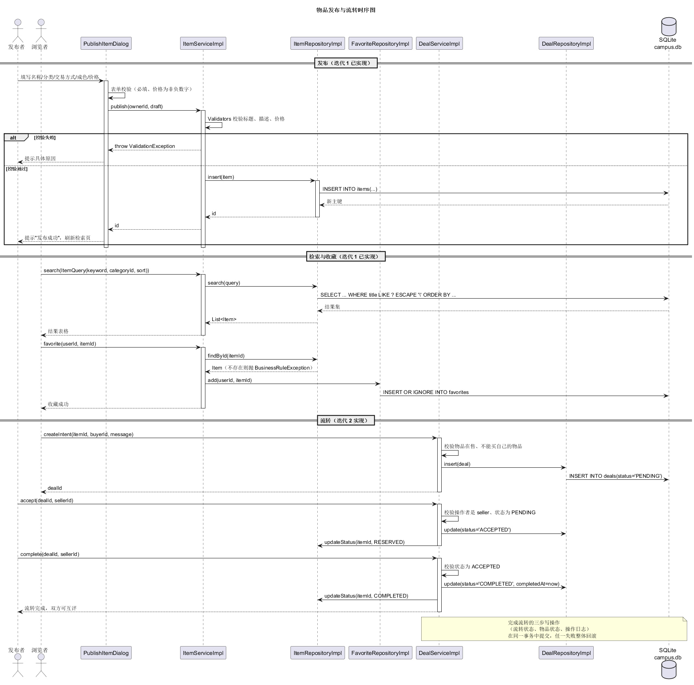

# 模块化设计

## 目录

- [一、业务模块划分](#一业务模块划分)
- [二、Maven模块与依赖](#二maven模块与依赖)
- [三、包结构与关键类](#三包结构与关键类)
- [四、接口与数据抽象](#四接口与数据抽象)
- [五、设计模式与复用](#五设计模式与复用)
- [六、关键流程](#六关键流程)
  - [6.1 登录](#61-登录)
  - [6.2 发布、检索与收藏](#62-发布检索与收藏)
  - [6.3 流转与评价](#63-流转与评价)
- [七、异常、日志与资源管理](#七异常日志与资源管理)
- [八、编码与测试约定](#八编码与测试约定)

## 一、业务模块划分

系统按用户、物品、流转、评价、统计与管理划分业务模块，按表现、业务、数据访问和公共契约组织代码。业务模块描述功能边界，Maven模块描述编译依赖，两者相互配合。

| 业务模块 | 主要职责 | 核心模型与接口 |
|---|---|---|
| 用户账号 | 注册、登录、密码维护、角色与账号状态 | User、AuthService、UserRepository |
| 物品管理 | 发布、修改、下架、详情、浏览量 | Item、Category、ItemService、ItemRepository |
| 检索与收藏 | 组合筛选、排序、分页、收藏增删 | ItemQuery、Favorite、FavoriteRepository |
| 流转记录 | 意向、接受、拒绝、完成、取消 | Deal、DealService、DealRepository |
| 评价信用 | 成交互评、评分与信用维护 | Review、ReviewService、ReviewRepository |
| 统计与管理 | 分类统计、减排估算、CSV、用户和分类管理 | StatsReport、StatsService、AdminService |
| 图形界面 | 菜单、表单、表格、弹窗和事件处理 | LoginFrame、MainFrame、各功能Panel |

## 二、Maven模块与依赖

| 模块 | 职责 | 依赖 |
|---|---|---|
| campus-core | 模型、枚举、异常、工具、查询对象、仓储和服务接口 | 无其他项目模块依赖 |
| campus-dao | JDBC、连接管理、初始化脚本、仓储实现和映射 | campus-core |
| campus-service | 业务规则、权限、字段校验、统计与流程编排 | campus-core |
| campus-ui | Swing窗口、面板、对话框和表格模型 | campus-core |
| campus-app | 主入口、组合根、对象装配和JAR打包 | 其余四个模块 |

箭头表示使用者依赖被使用者：

```text
campus-app -> campus-ui      -> campus-core
           -> campus-service -> campus-core
           -> campus-dao     -> campus-core
           -> campus-core
```

界面调用Service接口，Service依赖Repository接口，DAO实现数据存取。Bootstrap创建DaoFactory，将取得的仓储接口传给ServiceFactory，再把服务传给UiContext。ServiceFactory不直接依赖DaoFactory，跨层装配由campus-app负责。

## 三、包结构与关键类

```text
edu.campusloop
├─ core
│  ├─ model        9个领域模型与汇总对象
│  ├─ enums        角色、状态、方式、成色和排序枚举
│  ├─ exception    AppException及4个子类
│  ├─ repository   8个仓储接口
│  ├─ service      6个服务接口
│  ├─ query        ItemQuery及Builder
│  ├─ util         PasswordUtil、Validators、CsvUtil、DateTimes
│  ├─ config       AppConfig
│  └─ logging      AppLogger
├─ dao
│  ├─ db           DatabaseManager、SchemaInitializer
│  └─ repository   AbstractJdbcDao、RowMapper、ItemMapper、仓储实现
├─ service         业务实现与ServiceFactory
├─ ui              窗口、Panel、Dialog、TableModel、UiContext
└─ app             Main、Bootstrap
```

| 类或接口 | 职责 |
|---|---|
| User、Item、Category等模型 | 封装领域数据，使用ID建立持久化关联 |
| StatsReport | 汇总统计结果的DTO，不单独建表 |
| ItemQuery.Builder | 组合关键词、分类、价格、方式、状态、所属用户、排序和分页 |
| Repository接口 | 提供数据存取能力，避免业务层直接使用ResultSet |
| DatabaseManager | 单例数据库路径入口；openConnection新建连接，配置外键与WAL；提供事务回调 |
| SchemaInitializer | 按顺序执行schema.sql和seed.sql |
| AbstractJdbcDao<T> | 统一queryList、queryFirst、query、queryInt、queryLong、queryDouble、executeUpdate及insertAndReturnId |
| mapRow / RowMapper | 将结果集转换成模型；ItemMapper补充分类名和发布者昵称 |
| DaoFactory | 创建6个仓储实现，向上层暴露接口 |
| ServiceFactory | 接收仓储接口并装配认证、物品、管理和统计服务 |
| UiContext | 保存当前用户和界面使用的服务接口 |
| Bootstrap | 数据库初始化、工厂创建和界面装配 |



[类图源文件](UML/类图.puml)

## 四、接口与数据抽象

- 实体使用private字段与访问方法封装数据；输入校验、权限和状态规则集中在业务层。
- 单对象查询使用Optional，列表使用List，分类汇总使用Map；SQL异常不以SQLException直接穿透仓储接口。
- ItemQuery构建后不可变；默认第1页、每页20条，页长限制1～200；价格边界反向时交换上下限。
- Item的categoryName、ownerNickname等为查询显示字段，通过JOIN取得，不重复存入items表。
- ItemService.search在调用方未指定状态时追加ON_SALE；ItemRepository.search只按收到的条件查询。
- ItemService.detail会增加浏览量，普通列表展示不调用该方法。

完整签名见[接口契约](接口契约.md)。

## 五、设计模式与复用

| 模式 | 应用位置 | 作用 |
|---|---|---|
| 单例 | AppConfig、DatabaseManager | 集中管理配置及数据库入口 |
| 简单工厂 | DaoFactory、ServiceFactory | 集中创建和装配对象，调用方依赖接口 |
| 模板方法 | AbstractJdbcDao与mapRow扩展点 | 复用取连接、绑参、查询、映射、关闭和异常转换 |
| 建造者 | ItemQuery.Builder | 清晰组合多个可选检索条件 |

DatabaseManager不是连接池，单例管理器不意味着所有调用共享同一Connection。JDBC是数据库访问API，SQLite JDBC是具体驱动，Swing提供GUI组件，JUnit是测试框架；这些复用方式与设计模式分别说明。

信用计算策略和状态通知观察者可在后续重构时引入，其实现由相应迭代任务确定。

## 六、关键流程

### 6.1 登录

LoginFrame调用AuthService.login；服务完成输入校验、用户查询、账号状态检查及密码验证。成功时返回User，界面设置UiContext.currentUser并创建MainFrame；失败时由UiUtils.showError显示异常信息。

未知用户与密码错误提示相同，停用账号单独提示。操作日志当前采用尽力写入方式，日志失败记录warning。流程见下图。



[登录时序图源文件](UML/时序图-登录.puml)

### 6.2 发布、检索与收藏

发布流程：PublishItemDialog构造草稿，服务校验用户、字段和分类，仓储插入物品并返回主键，随后记录操作日志。

检索流程：界面通过ItemQuery.Builder构建条件，服务补充默认状态，仓储使用PreparedStatement与转义后的LIKE条件查询，ItemMapper映射数据，表格模型展示结果。价格区间与分页已具备底层接口，界面控件由后续联调接入。

收藏流程：服务检查用户和物品，调用FavoriteRepository.add；数据库联合主键与INSERT OR IGNORE保证重复收藏不生成重复记录。

### 6.3 流转与评价

流转设计包括PENDING、ACCEPTED、COMPLETED、CANCELLED、REJECTED状态。接受时预订物品，完成时共同更新流转记录、物品状态和日志；成交双方各可评价一次。流程见下图。



[物品流转时序图源文件](UML/时序图-物品流转.puml)

Deal/Review仓储已在迭代2实现，支持按用户、按物品、按状态查询以及评价唯一性和平均分统计；流转状态机、参与者权限与信用更新仍由服务层负责，随业务实现接入。多表写入使用DatabaseManager.inTransaction共享同一连接，见[数据库设计](数据库设计.md#五事务与一致性)。

## 七、异常、日志与资源管理

```text
AppException
├─ ValidationException       字段格式或必填项不合法
├─ AuthenticationException   认证失败
├─ BusinessRuleException     越权、对象不存在或业务规则不满足
└─ DataAccessException       JDBC访问失败
```

DAO捕获SQLException后由`SqlErrors`按约束类别翻译成用户可读的中文提示（数据已存在、关联数据不存在、取值不符合要求等），SQL语句与原始异常保存在`AppException.getDetail()`中，只写入日志。服务层抛出对应业务异常；`UiUtils.showError`展示message并记录detail与堆栈。用户界面不再出现表名、列名或SQL片段。

日志使用java.util.logging，运行文件为logs/campus-loop.log。operation_logs保存登录、注册、发布、收藏和管理等关键操作；action当前为中文操作名称。CSV导出接口由后续迭代接通。

连接、语句和结果集使用try-with-resources释放。Swing界面在EDT中更新；耗时查询需要在联调和性能优化时分离为后台任务。

## 八、编码与测试约定

| 项目 | 约定 |
|---|---|
| 编码与版本 | UTF-8，Java源码和字节码目标1.8 |
| 命名 | 类名大驼峰，方法小驼峰，常量全大写，SQL列名下划线 |
| 资源 | 明确连接归属，异常路径同样释放资源 |
| 测试 | 业务层注入仓储替身；DAO使用独立临时数据库 |
| 接口变更 | 同步接口契约、调用方、UML与测试 |
| 集成与重构 | 保存走查、静态分析和回归结果，按迭代计划完成 |
